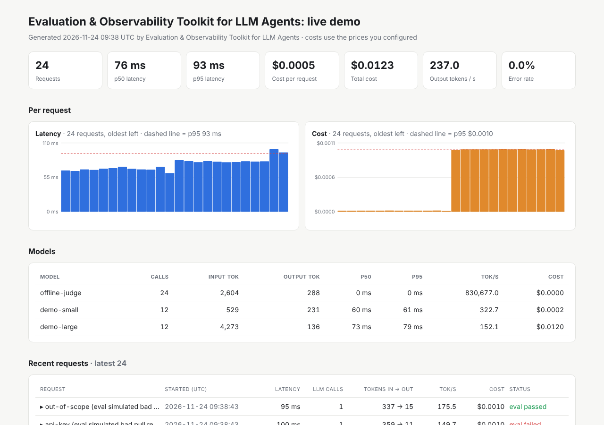
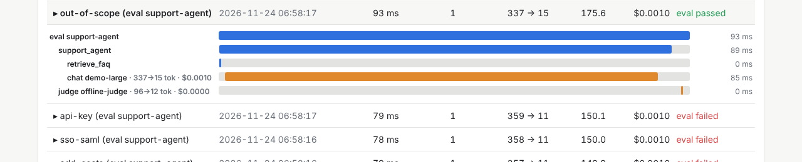

# Evaluation & Observability Toolkit for LLM Agents

[](https://github.com/Harika056/llm-agent-eval-toolkit/actions/workflows/ci.yml)
[](https://pypi.org/project/llm-agent-eval-toolkit/)
[](https://pypi.org/project/llm-agent-eval-toolkit/)

**Tracing, evaluation and CI regression gates for LLM agents.** · [Live demo dashboard](https://harika056.github.io/llm-agent-eval-toolkit/)

This toolkit answers four questions about an LLM agent:

1. **What did each request cost, and where did the time go?** Every agent run, step and LLM call becomes an OpenTelemetry span with latency, input/output tokens, tokens per second and USD cost.
2. **Is it still giving good answers?** A golden-dataset runner scores outputs with rule-based checks and an LLM-as-judge.
3. **Can the judge be trusted?** Compare its grades with human labels using Cohen's kappa.
4. **Did this pull request make things worse?** A CI gate fails the build when accuracy, latency or cost regress past limits you set.

It works with any model provider (OpenAI, Anthropic, Gemini, local models), adds no SDK dependency, and its only runtime dependencies are the OpenTelemetry SDK and PyYAML.

```
pip install llm-agent-eval-toolkit
```

---

## 1. Trace an agent

```python
import llm_agent_eval_toolkit as et
from openai import OpenAI

et.configure("support-agent", store="agent_eval.db", pricing="pricing.yaml")
client = OpenAI()

@et.traced_step()
def retrieve(question: str) -> str:
    ...

@et.traced_agent("support_agent")
def answer(question: str) -> str:
    context = retrieve(question)
    with et.llm_call("gpt-4o-mini", provider="openai") as call:
        resp = client.chat.completions.create(
            model="gpt-4o-mini",
            messages=[{"role": "user", "content": f"{context}\n\n{question}"}],
        )
        call.record(resp)  # reads token counts from the response
    return resp.choices[0].message.content
```

Each LLM span carries the [OpenTelemetry GenAI semantic conventions](https://opentelemetry.io/docs/specs/semconv/gen-ai/) (`gen_ai.request.model`, `gen_ai.usage.input_tokens`, …) plus `agent_eval.latency_ms`, `agent_eval.tokens_per_second` and `agent_eval.cost_usd`. The agent's root span gets the request totals.

Spans go to a local SQLite file by default. Add any OpenTelemetry exporter to send them to Jaeger, Grafana Tempo, Honeycomb or Datadog as well:

```python
from opentelemetry.exporter.otlp.proto.http.trace_exporter import OTLPSpanExporter
et.configure("support-agent", exporters=[OTLPSpanExporter()], batch=True)
```

**Prices.** The toolkit ships no prices, because providers change them. Put yours in a YAML file (USD per million tokens); dated model names match by prefix:

```yaml
models:
  gpt-4o-mini: { input_per_million: 0.15, output_per_million: 0.60 }
```

Token counts are read from OpenAI (Chat Completions and Responses), Anthropic and Gemini responses, or passed directly: `call.record(input_tokens=812, output_tokens=96)`. See [docs/integrations.md](docs/integrations.md).

### Dashboard

```
agent-eval dashboard --traces agent_eval.db -o dashboard.html
agent-eval summary agent_eval.db
```

The dashboard is one self-contained HTML file. It shows p50/p95 latency, cost per request, tokens per second and error rate, a per-model table, and a waterfall of every step and LLM call in each request.





## 2. Evaluate on a golden dataset

`golden.jsonl`, one case per line:

```json
{"id": "refund-basic", "input": "How do I get a refund?", "expected": "Refunds are issued to the original payment method within 5-7 business days."}
```

`eval.yaml`:

```yaml
name: support-agent
target: myapp.agent:answer          # called with each case's input
dataset: golden.jsonl
pricing: pricing.yaml
scorers:
  - type: contains                  # rule-based: must mention these
    phrases: ["5-7 business days"]
  - type: not_contains
    phrases: ["@internal"]
  - type: llm_judge                 # rubric-based grading by a model
    judge: myapp.judges:gpt_judge   # any function prompt -> reply text
    rubric: "5 = correct and complete; 3 = partly right; 1 = wrong or made up."
    pass_threshold: 4
```

```
agent-eval eval eval.yaml -o results.json
```

A case passes when every scorer passes. The results file records accuracy, per-scorer pass rates, p50/p95 latency, tokens and cost per case. The judge's own calls are kept out of the agent's cost.

Built-in scorers: `exact_match`, `contains`, `not_contains`, `regex`, `json_fields`, `numeric_close`, `llm_judge` and `custom` (any function `(case, output) -> bool | float`). The same is available from Python:

```python
report = et.run_eval(answer, "golden.jsonl", [et.Contains(), et.LLMJudge(gpt_judge, rubric)])
report.save("results.json")
```

## 3. Check the judge against humans

An LLM judge is only useful if it agrees with people. Label a sample of outputs yourself (`id,label` CSV, same 1–5 scale), then:

```
agent-eval agreement --judge results.json --human human_labels.csv
```

This reports Cohen's kappa (agreement corrected for chance), quadratic-weighted kappa for ordered grades, raw agreement, a confusion matrix and the cases where you and the judge disagree. Kappa matches scikit-learn's `cohen_kappa_score`. See [docs/judge-agreement.md](docs/judge-agreement.md) for how to collect labels you can trust.

## 4. Gate pull requests in CI

```
agent-eval gate results.json --baseline main-results.json --thresholds thresholds.yaml
```

```yaml
# thresholds.yaml
min_accuracy: 0.85
max_accuracy_drop: 0.02          # vs main
max_p95_latency_increase: 0.25   # +25% max
max_cost_increase: 0.20          # +20% max
max_newly_failing_cases: 0
scorers:
  llm_judge: { min_pass_rate: 0.8 }
```

It exits with code 1 on any breach and writes a table to the GitHub job summary:

| Check | Baseline | This run | Change | Limit | Result |
|---|---|---|---|---|---|
| Accuracy vs baseline | 100.0% | 8.3% | -91.7 pts | drop ≤ 5 pts | ❌ |
| p95 latency vs baseline | 66 ms | 85 ms | +28.6% | +25% max | ❌ |
| Cost per case vs baseline | $0.00002 | $0.00100 | +5425.3% | +20% max | ❌ |

(Output from the offline example's simulated regression.)

Or use the GitHub Action, which also fetches the baseline from your main branch:

```yaml
# .github/workflows/eval.yml
on:
  push: { branches: [main] }
  pull_request:
permissions: { contents: read, actions: read }
jobs:
  eval:
    runs-on: ubuntu-latest
    steps:
      - uses: actions/checkout@v4
      - uses: Harika056/llm-agent-eval-toolkit@v0.1.0
        with:
          config: evals/eval.yaml
          thresholds: evals/thresholds.yaml
        env:
          OPENAI_API_KEY: ${{ secrets.OPENAI_API_KEY }}
```

Details in [docs/ci.md](docs/ci.md).

## Testing agents with pytest

Installing the toolkit adds a pytest fixture that captures spans in memory:

```python
def test_agent_stays_within_budget(agent_eval_spans):
    answer("How do I reset my password?")
    assert len(agent_eval_spans.llm_calls) <= 2
    assert agent_eval_spans.steps == ["retrieve"]
    assert agent_eval_spans.input_tokens < 4_000
```

## Try it with no API key

[`examples/support_agent`](examples/support_agent) runs the whole loop offline with a stand-in model and judge:

```bash
cd examples/support_agent
agent-eval eval eval.yaml -o baseline.json
AGENT_VARIANT=regressed agent-eval eval eval.yaml -o pr.json
agent-eval gate pr.json --baseline baseline.json --thresholds thresholds.yaml   # exits 1
agent-eval dashboard --traces agent_eval.db --report pr.json -o dashboard.html
```

## Development

```bash
pip install -e ".[dev]"
pytest && ruff check src tests examples
```

MIT licensed.
